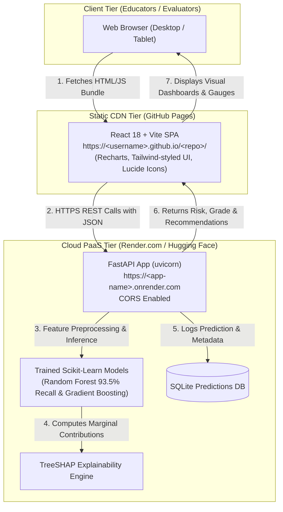

# Cloud & GitHub Pages Deployment Guide
## Option 1: Decoupled Full-Stack Architecture (GitHub Pages + Cloud PaaS Backend)

This document provides a comprehensive, step-by-step walkthrough for deploying the **Smart Student Performance Prediction and Analytics System** using **Option 1**.

---

## 1. System Architecture Overview

### Why Option 1?
- **GitHub Pages** is a static hosting platform (CDN). It serves pre-compiled HTML, CSS, JavaScript, and static images. It **cannot run Python runtimes**, manage background daemons (`uvicorn`), execute Scikit-Learn pipelines in RAM, or generate SHAP game-theoretic explanations in real-time.
- **Option 1** pairs the free global CDN of **GitHub Pages** for the React frontend with a free cloud container host (**Render.com** or **Hugging Face Spaces**) for the Python FastAPI + ML backend.



---

## 2. Step-by-Step Deployment Instructions

### Phase 1: Push Project to GitHub

If you have not already pushed your code to GitHub, follow these commands in PowerShell inside `c:\Users\KEERTHI\Downloads\DSES IA PROJECT`:

```powershell
# 1. Initialize git repository in this project directory
git init -b main

# 2. Stage all project files (models, data, frontend, backend, workflows)
git add .

# 3. Commit the project
git commit -m "Initial commit: Complete runnable ML academic analytics system"

# 4. Link to your empty GitHub repository (create one on github.com first)
git remote add origin https://github.com/<YOUR_GITHUB_USERNAME>/<YOUR_REPO_NAME>.git

# 5. Push to GitHub
git push -u origin main
```

---

### Phase 2: Deploy the FastAPI Backend to Render (Free)

[Render.com](https://render.com) offers a 100% free cloud tier for hosting Python web services with automatic HTTPS certificates.

1. **Sign Up / Log In**: Visit [https://render.com](https://render.com) and log in with your GitHub account.
2. **Create New Web Service**:
   - In the Render Dashboard, click **New +** and select **Web Service**.
   - Choose **Build and deploy from a Git repository** and connect your GitHub project repository.
3. **Configure Service Settings**:
   - **Name**: `student-performance-api` (or any unique name you prefer)
   - **Region**: Choose the closest region (e.g., Singapore, Frankfurt, Oregon, Ohio)
   - **Branch**: `main`
   - **Root Directory**: Leave blank (uses the project root)
   - **Runtime**: `Python 3`
   - **Build Command**: `pip install -r requirements.txt`
   - **Start Command**: `uvicorn backend.app.main:app --host 0.0.0.0 --port $PORT`
   - **Instance Type**: Select **Free** (0.1 CPU, 512 MB RAM)
4. **Deploy**:
   - Click **Create Web Service**.
   - Render will clone your repository, install dependencies, load the trained `.joblib` models, and launch FastAPI.
   - When the build finishes, you will see a green **Live** badge with your public URL:
     `https://student-performance-api.onrender.com`
5. **Verify Backend Health**:
   - Open `https://<your-render-url>.onrender.com/docs` in your browser.
   - You should see the interactive FastAPI Swagger UI with all 8 routers (`/api/health`, `/api/overview`, `/api/predict`, etc.).

> [!NOTE]
> **Free Tier Spin-Down**: Render's free tier automatically spins down the container after 15 minutes of inactivity. When a new request arrives, it wakes up automatically in approximately 30–50 seconds. Subsequent requests respond in under 50ms.

---

### Phase 3: Configure GitHub Pages & Environment Variable

Now link your React frontend on GitHub Pages to your live Render backend:

1. **Add the Backend URL Variable to GitHub**:
   - In your GitHub repository, navigate to:
     `Settings` ➔ `Secrets and variables` ➔ `Actions` ➔ **Variables** tab.
   - Click **New repository variable**.
   - **Name**: `VITE_API_BASE_URL`
   - **Value**: `https://<your-render-url>.onrender.com` (do not include a trailing slash)
   - Click **Add variable**.

2. **Enable GitHub Pages via Actions**:
   - In your GitHub repository, navigate to:
     `Settings` ➔ `Pages`.
   - Under **Build and deployment**:
     - **Source**: Select **GitHub Actions**.

3. **Trigger Deployment**:
   - Go to the **Actions** tab in your GitHub repository.
   - You will see the **Deploy Frontend to GitHub Pages** workflow.
   - If not already running, click **Run workflow** ➔ **Run workflow**.
   - The workflow will:
     1. Set up Node.js 20.
     2. Inject `VITE_API_BASE_URL`.
     3. Compile Vite with relative base path (`./`).
     4. Publish the artifact to GitHub Pages.

4. **Access Your Live System**:
   - Once the action completes with a green checkmark, GitHub Pages will display your live URL:
     `https://<YOUR_GITHUB_USERNAME>.github.io/<YOUR_REPO_NAME>/`

---

## 3. Configuration Files Reference

All necessary configuration files have been created in this repository:

| File | Purpose |
| :--- | :--- |
| [`.github/workflows/deploy.yml`](file:///.github/workflows/deploy.yml) | GitHub Actions workflow to build Vite React and deploy to GitHub Pages. |
| [`frontend/vite.config.js`](file:///frontend/vite.config.js) | Configured with `base: './'` for subpath routing on GitHub Pages. |
| [`frontend/src/services/api.js`](file:///frontend/src/services/api.js) | Dynamically switches between local proxy (`/api`) and remote URL (`VITE_API_BASE_URL`). |
| [`render.yaml`](file:///render.yaml) | Render Blueprint configuration for zero-setup cloud deployment. |
| [`Procfile`](file:///Procfile) | Standard process file for PaaS platforms (Heroku, Railway, Render). |
| [`Dockerfile`](file:///Dockerfile) | Container specification for Docker-based hosts (Hugging Face Spaces, Fly.io). |
| [`requirements.txt`](file:///requirements.txt) | Cloud Python dependencies list for automated installation. |

---

## 4. Alternative: Deploying Backend to Hugging Face Spaces (No Sleep Mode)

If you prefer a 100% free backend that **does not go to sleep**:

1. Create a free account at [huggingface.co](https://huggingface.co).
2. Click **New Space** ➔ Name: `student-performance-backend`.
3. Select **Space SDK**: **Docker** (Blank).
4. Select **Space hardware**: **CPU basic · 2 vCPU · 16 GB RAM · Free**.
5. Push this repository or connect your GitHub repo.
6. Hugging Face will automatically use the included [`Dockerfile`](file:///Dockerfile).
7. Your permanent backend URL will be:
   `https://<your-hf-username>-student-performance-backend.hf.space`
8. Set `VITE_API_BASE_URL` in your GitHub repository variables to this URL.

---

## 5. Local vs. Cloud Compatibility

The codebase has been engineered so **zero code changes are needed** when switching between local execution and cloud deployment:

| Environment | Frontend Base URL | Backend URL | How to Run |
| :--- | :--- | :--- | :--- |
| **Local Machine** | `http://localhost:5173` | `http://localhost:8000` | Double-click `run_all.bat` |
| **Option 1 Cloud** | `https://<user>.github.io/<repo>/` | `https://<app>.onrender.com` | Automated via GitHub Actions |

Both modes execute the identical Scikit-Learn pipelines, the same 32 early-warning features, the identical SHAP explainability calculations, and the same live SQLite database.
