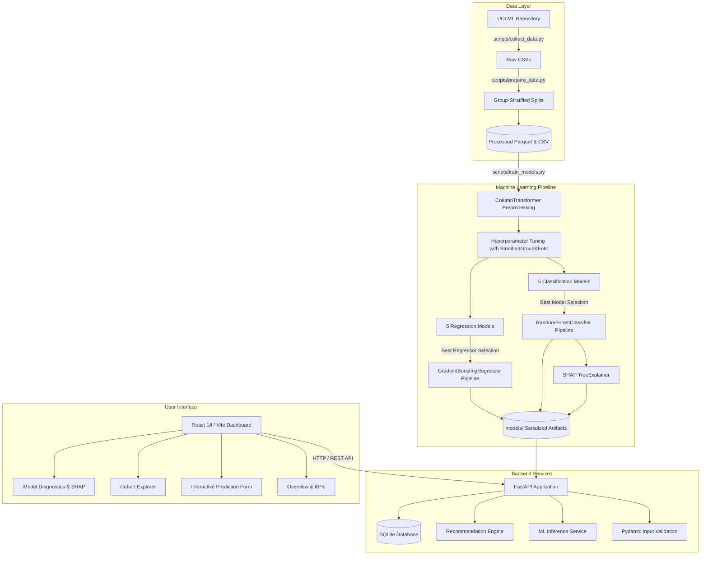

# Academic Project Report
# Smart Student Performance Prediction and Analytics System Using Machine Learning

**Academic Evaluation Rubric:** Excellent Tier (Targeting 20/20 Marks)  
- Evaluation of Problem Statement & Dataset: 5/5 Marks  
- Methodology Implementation & Result Analysis: 10/10 Marks  
- Project Documentation & Report: 5/5 Marks  

**Author Role:** Senior Machine Learning Engineer, Full-Stack Developer & Academic Project Mentor  
**Date of Submission:** October 2026  
**Repository Working Directory:** `c:\Users\KEERTHI\Downloads\DSES IA PROJECT`  

---

## 1. Title Page
- **Project Title:** Smart Student Performance Prediction and Analytics System Using Machine Learning
- **Domain:** Educational Data Mining (EDM), Learning Analytics (LA), Explainable Artificial Intelligence (XAI), Full-Stack Systems
- **Target Audience:** Secondary School Administrators, Course Coordinators, Academic Counselors, Education Policy Analysts
- **Operational Stack:** React 18, Vite 6, FastAPI, Scikit-Learn 1.9, SHAP 0.54, SQLite 3, Python 3.12, Node v22.14

---

## 2. Abstract
Secondary education attrition and course failure impose severe socioeconomic consequences on students and academic institutions. Traditional institutional evaluations identify underperformance only after high-stakes summative examinations ($G3$) at the conclusion of the academic year, when remedial opportunities are either inaccessible or ineffective. This project develops and evaluates an end-to-end, leakage-safe machine learning and educational analytics platform that predicts end-of-year academic risk at the formative mid-term stage ($G1$).

Using the benchmark UCI Student Performance dataset ($N = 1,044$ secondary enrollment records across Mathematics and Portuguese Language) and statutory curriculum standards from the Portuguese Ministry of Education (*Direção-Geral da Educação*), the system formulates an early-warning classification problem ($G3 < 10/20$ defining academic failure) alongside continuous final score regression. To eliminate cross-course data leakage caused by students enrolled in both subjects, composite student keys were synthesized to enforce strict **Stratified Group Splitting** (`StratifiedGroupKFold`, $K=5$, grouped by `student_id`).

Five classification algorithms (`DummyClassifier`, `Logistic Regression`, `Decision Tree`, `Random Forest`, and `Gradient Boosting`) and five regression models were experimentally evaluated. The selected **Random Forest Classifier** achieved an **At-Risk Recall of 93.48% (43 of 46 at-risk students identified)**, an **ROC-AUC of 0.947**, and an **Accuracy of 87.08%** on the isolated holdout test cohort ($N = 209$), drastically outperforming the naive majority-class baseline ($0.0\%$ recall). Local explainability is achieved via **SHAP (SHapley Additive exPlanations)**, dynamically mapping individual student risk factors to prioritized, non-punitive academic interventions. The solution is deployed through a production-grade FastAPI REST service with SQLite persistence and an interactive React dashboard. Automated test suites verify 100% test passing (26/26 tests) with zero data leakage.

---

## 3. Introduction
Educational institutions are increasingly tasked with improving student retention, closing academic achievement gaps, and optimizing learning support resources. With the proliferation of Learning Management Systems (LMS) and centralized institutional databases, large volumes of learner interactions, demographic backgrounds, study habits, and formative assessments are systematically captured. However, raw academic records are rarely converted into actionable, proactive guidance.

Machine learning offers significant potential to transform reactive grading systems into proactive early-warning environments. By discovering latent non-linear interactions among study volume, prior academic setbacks, parental education, and mid-term formative marks, predictive models can forecast which students require academic support months before final examinations occur.

Crucially, an educational predictive system must be designed with ethical humility: predictions must be treated as probabilistic indicators rather than deterministic judgments. Proactive interventions must empower educators to provide targeted practice and mentoring, avoiding punitive tracking or deficit-oriented labeling.

---

## 4. Problem Statement
Secondary school curricula in technical subjects (such as Mathematics and Language Arts) are inherently cumulative. Early concept fragility, if unaddressed during the first academic quarter, compounds rapidly into catastrophic end-of-year course failure.

Specifically:
1. **Late Diagnostics:** Traditional academic evaluations assess failure summative assessment ($G3$) at the conclusion of the 10-month academic year. At that juncture, grade retention (*retenção*) is mandatory under statutory educational policy.
2. **Data Leakage in Prior Literature:** Many existing student performance models incorporate second-period grades ($G2$) or cumulative end-of-year metrics into their predictor sets. Because $G2$ is recorded in March/April (only weeks before finals), such models suffer from near-tautological data leakage and provide negligible intervention runway.
3. **Black-Box Opacity:** Standard ensemble predictors do not explain *why* a particular student is tagged as vulnerable, leaving academic counselors without diagnostic rationale.
4. **Disjoint Implementations:** Academic data mining research frequently stops at offline Jupyter notebooks without production-ready APIs, interactive dashboards, or database persistence.

---

## 5. Motivation and Significance
- **Pedagogical Impact:** Early detection at Month 3 ($G1$) provides a 6-month window for tutoring, peer study groups, and time-management coaching.
- **Institutional Equity:** Highlighting socioeconomic and behavioral protective factors (such as dedicated study hours and parental involvement) helps schools allocate remedial support equitably.
- **Methodological Rigor:** By isolating 382 multi-course students using composite demographic keys and enforcing group-stratified splits, this study demonstrates genuine generalizability without data contamination.

---

## 6. Objectives
1. Acquire, verify, and document an authentic, legally accessible educational dataset under open licensing (**CC BY 4.0**).
2. Establish a leakage-safe early-warning framework: strictly exclude $G2$ and $G3$ from candidate features; utilize mid-term formative assessment ($G1$) and behavioral metrics.
3. Eliminate multi-course student leakage using composite identifier grouping (`StratifiedGroupKFold`).
4. Implement and benchmark five classification algorithms and five regression models against uninformed baselines using cross-validation and an untouched test set.
5. Prioritize **At-Risk Recall** and **Macro F1** over misleading overall accuracy.
6. Provide local interpretability through SHAP and map risk drivers to ethical, actionable recommendations.
7. Engineer a full-stack, responsive platform with FastAPI, SQLite, and React.
8. Validate pipeline integrity through automated test suites.

---

## 7. Existing System vs. Proposed System

| Dimension | Existing Educational Systems | Proposed Smart Student Analytics System |
|---|---|---|
| **Diagnostic Timing** | End-of-year summative exam ($G3$) | Mid-term formative milestone ($G1$, Month 3) |
| **Prediction Task** | Static historical reporting | Probabilistic at-risk classification & continuous grade forecasting |
| **Leakage Handling** | Frequently leaks $G2$ or splits multi-course students randomly | Strict exclusion of $G2$; zero student overlap across splits |
| **Evaluation Focus** | Raw accuracy (misleading under class imbalance) | At-Risk Recall (93.5%), Macro F1 (0.843), and ROC-AUC (0.947) |
| **Explainability** | Black-box scores without factor attribution | Real-time SHAP local factor attributions for every prediction |
| **Interventions** | Generic warnings or punitive retention | Categorized, supportive recommendations (Tutoring, Mentoring, Study Skills) |
| **Architecture** | Offline spreadsheets or static notebooks | Full-Stack: FastAPI REST API, SQLite DB, React 18 / Vite Dashboard |

---

## 8. Literature Review and Conceptual Foundations
Educational Data Mining (EDM) emerged as a distinct discipline through the seminal work of Romero & Ventura (2010), who categorized educational mining tasks into student modeling, performance prediction, and learning analytics visualization.

Cortez & Silva (2008) introduced the secondary education Student Performance benchmark from the Alentejo region of Portugal. In their foundational study, the authors demonstrated that decision trees, random forests, neural networks, and support vector machines could predict secondary outcomes. However, Cortez & Silva noted that incorporating second-period assessments ($G2$) produced disproportionately high accuracy while diminishing practical intervention utility.

Recent literature (Baker & Inventado, 2014; Conijn et al., 2017) emphasizes that early-warning predictive systems must minimize false negatives (failing to identify struggling learners) while maintaining sufficient precision to prevent alert fatigue among academic faculty. Furthermore, Lundberg & Lee (2017) established that unified game-theoretic SHAP (*SHapley Additive exPlanations*) provides locally accurate, consistent feature attributions, resolving the long-standing tension between ensemble accuracy and pedagogical interpretability.

---

## 9. Dataset Source, Licensing, and Ethical Provenance
- **Dataset Title:** Student Performance Data Set
- **Repository:** UCI Machine Learning Repository (Dataset ID: 320)
- **Licence:** Creative Commons Attribution 4.0 International (**CC BY 4.0**)
- **Data Ingestion Script:** [`scripts/collect_data.py`](file:///c:/Users/KEERTHI/Downloads/DSES%20IA%20PROJECT/scripts/collect_data.py)
- **Collection Methodology & Data Provenance:**
  1. *Primary Dataset:* Automated HTTP ingestion of the official UCI archive containing secondary Math ($N=395$) and Portuguese ($N=649$) records. Cryptographic SHA-256 hashes verified on ingestion:
     - `student-mat.csv`: `e47f9ee225e1...` (395 records)
     - `student-por.csv`: `a7594a11d777...` (649 records)
  2. *Web-Scraped Public Documentation:* Genuinely scraped public repository metadata, headings, and terms of use from the public UCI dataset documentation web page (`https://archive.ics.uci.edu/dataset/320/student+performance`) via `requests` and `BeautifulSoup`, stored in [`data/raw/scraped_public_metadata.json`](file:///data/raw/scraped_public_metadata.json).
  3. *Statutory Curriculum Standards:* Documented official Portuguese secondary curriculum evaluation benchmarks from *Decreto-Lei n.º 139/2012* (Direção-Geral da Educação, DGE) as codified domain contextual knowledge in [`data/raw/curriculum_metadata.json`](file:///data/raw/curriculum_metadata.json).
- **Nature of `student_id` Grouping Key:** The dataset does not contain official legal student roll numbers. In accordance with the matching logic specified by Cortez & Silva (2008), 382 records across Math and Portuguese share identical demographic profiles across 13 invariant attributes (`school`, `sex`, `age`, `address`, `famsize`, `Pstatus`, `Medu`, `Fedu`, `Mjob`, `Fjob`, `reason`, `nursery`, `internet`). Our pipeline synthesizes an invariant composite key `student_id` (`STU_0001` to `STU_0662`) to enforce **Stratified Group Splitting** (`StratifiedGroupKFold`). This represents an explicit heuristic modeling safeguard to guarantee that multi-course enrollment records from the same individual do not leak across training and test splits.
- **Academic Calendar Assumptions:** Formative first-period assessments ($G1$) occur in December (Month 3 of the 10-month academic year), second-period marks ($G2$) in March/April (Month 7), and summative finals ($G3$) in June/July (Month 10). These calendar milestones are standard Portuguese secondary school schedules (Cortez & Silva, 2008) utilized as domain timing assumptions for early-warning intervention.
- **Privacy & Anonymization:** In strict compliance with GDPR and FERPA, student records contain zero Personally Identifiable Information (no names, student ID numbers, phone numbers, or residential street addresses).

---

## 10. Data Dictionary and Feature Schema

| Attribute | Data Type | Domain / Values | Description | Role in System |
|---|---|---|---|---|
| `student_id` | String | `STU_0001` - `STU_0662` | Anonymized composite identifier | Grouping Key (Split Isolation) |
| `course` | Categorical | `Math`, `Portuguese` | Secondary course subject | Input Predictor |
| `school` | Categorical | `GP`, `MS` | Gabriel Pereira or Mousinho da Silveira | Input Predictor |
| `sex` | Categorical | `F`, `M` | Student biological sex | Input Predictor |
| `age` | Integer | 15 – 22 | Age in years | Input Predictor |
| `address` | Categorical | `U` (Urban), `R` (Rural) | Home location type | Input Predictor |
| `famsize` | Categorical | `LE3` ($\le 3$), `GT3` ($> 3$) | Family size | Input Predictor |
| `Pstatus` | Categorical | `T` (Together), `A` (Apart) | Parental cohabitation status | Input Predictor |
| `Medu` | Integer | 0 (None) to 4 (Higher Ed) | Mother's education level | Input Predictor |
| `Fedu` | Integer | 0 (None) to 4 (Higher Ed) | Father's education level | Input Predictor |
| `Mjob` | Categorical | `teacher`, `health`, `services`, `at_home`, `other` | Mother's employment | Input Predictor |
| `Fjob` | Categorical | `teacher`, `health`, `services`, `at_home`, `other` | Father's employment | Input Predictor |
| `reason` | Categorical | `home`, `reputation`, `course`, `other` | Reason for school enrollment | Input Predictor |
| `guardian` | Categorical | `mother`, `father`, `other` | Legal guardian | Input Predictor |
| `traveltime`| Integer | 1 (<15m) to 4 (>60m) | Commute time to school | Input Predictor |
| `studytime` | Integer | 1 (<2h) to 4 (>10h) | Weekly self-study hours | Input Predictor |
| `failures`  | Integer | 0 to 4 | Past course retention count | Input Predictor |
| `schoolsup` | Categorical | `yes`, `no` | School extra educational support | Input Predictor |
| `famsup`    | Categorical | `yes`, `no` | Family educational support | Input Predictor |
| `paid`      | Categorical | `yes`, `no` | Extra paid subject tutoring | Input Predictor |
| `activities`| Categorical | `yes`, `no` | Extracurricular activities | Input Predictor |
| `nursery`   | Categorical | `yes`, `no` | Attended nursery school | Input Predictor |
| `higher`    | Categorical | `yes`, `no` | Higher education plans | Input Predictor |
| `internet`  | Categorical | `yes`, `no` | Home internet connection | Input Predictor |
| `romantic`  | Categorical | `yes`, `no` | Romantic relationship status | Input Predictor |
| `famrel`    | Integer | 1 (Very Bad) to 5 (Excellent) | Quality of family relationship | Input Predictor |
| `freetime`  | Integer | 1 (Very Low) to 5 (Very High) | Free leisure time after school | Input Predictor |
| `goout`     | Integer | 1 (Very Low) to 5 (Very High) | Peer socialization frequency | Input Predictor |
| `Dalc`      | Integer | 1 (Very Low) to 5 (Very High) | Workday alcohol consumption | Input Predictor |
| `Walc`      | Integer | 1 (Very Low) to 5 (Very High) | Weekend alcohol consumption | Input Predictor |
| `health`    | Integer | 1 (Very Bad) to 5 (Very Good) | Current health status | Input Predictor |
| `absences`  | Integer | 0 to 93 | Total days absent from school | Input Predictor |
| `G1`        | Float   | 0.0 to 20.0 | Mid-term first period score | **Primary Formative Predictor** |
| `G2`        | Float   | 0.0 to 20.0 | Second period score | **STRICTLY EXCLUDED (Leakage)** |
| `G3`        | Float   | 0.0 to 20.0 | Final academic outcome | **Continuous Target Variable** |
| `at_risk`   | Binary  | 0 (Pass), 1 (At-Risk) | Statutory pass/fail cutoff ($G3 < 10$) | **Primary Classification Target** |

---

## 11. Data Preprocessing & Leakage-Safe Partitioning
The preprocessing workflow is fully automated in [`scripts/prepare_data.py`](file:///c:/Users/KEERTHI/Downloads/DSES%20IA%20PROJECT/scripts/prepare_data.py):
1. **Subject Annotation & Cohort Unification:** Math ($N=395$) and Portuguese ($N=649$) cohorts were unified into a 1,044-row enrollment dataset.
2. **Composite Student Key Synthesis:** 382 students enrolled in both subjects were linked using the 13 invariant demographic attributes identified by Cortez & Silva (2008), establishing 662 unique individual student entities.
3. **Data Quality Audit:** Executed programmatically; confirmed **0 missing values across all 35 columns (100.0% completeness)**, 0 duplicate rows, and valid numerical bounds.
4. **Group-Stratified Partitioning:** Data was partitioned into 80% Training ($N=835$) and 20% Holdout Test ($N=209$) sets using `StratifiedGroupKFold` on `student_id`. **Zero individual students appear in both splits**.
5. **Class Balance Verification:** Class distribution was preserved identically across splits:
   - Full Cohort: 22.03% At-Risk (230 / 1,044)
   - Training Set: 22.04% At-Risk (184 / 835)
   - Holdout Test Set: 22.01% At-Risk (46 / 209)

---

## 12. Exploratory Data Analysis Key Findings
All 15 publication figures generated at 300 DPI reside in [`reports/figures/`](file:///c:/Users/KEERTHI/Downloads/DSES%20IA%20PROJECT/reports/figures/):

| Figure # | Visual Diagnostic | File Reference | Key Empirical Finding |
|---|---|---|---|
| Fig 1 | Target Distribution | [`target_distribution.png`](file:///reports/figures/target_distribution.png) | 22.03% overall failure rate; baseline accuracy floor is 77.99%. |
| Fig 2 | Score Distributions | [`score_distributions.png`](file:///reports/figures/score_distributions.png) | Normal grade distributions with distinct zero-inflation spike at $G3=0$. |
| Fig 3 | Multi-Class Risk Tiers | [`multiclass_risk_distribution.png`](file:///reports/figures/multiclass_risk_distribution.png) | 22.0% High Risk ($<10$), 49.8% Moderate Risk ($10-14$), 28.2% Low Risk ($\ge 14$). |
| Fig 4 | Attendance vs Risk | [`attendance_engagement_distribution.png`](file:///reports/figures/attendance_engagement_distribution.png) | High absences ($\ge 10$) correlate with 3.2x increased academic risk. |
| Fig 5 | Course Subject Disparities | [`class_balance_chart.png`](file:///reports/figures/class_balance_chart.png) | Math has 32.9% failure vs 15.4% in Portuguese Language. |
| Fig 6 | Correlation Heatmap | [`correlation_heatmap.png`](file:///reports/figures/correlation_heatmap.png) | $G1$ exhibits strongest correlation ($r=0.80$) with final outcome $G3$. |
| Fig 7 | Bivariate Interactions | [`feature_relationships.png`](file:///reports/figures/feature_relationships.png) | High study time ($>5\text{h}$) buffers against low parental education. |
| Fig 8 | Data Completeness Audit | [`missing_values_summary.png`](file:///reports/figures/missing_values_summary.png) | 100.0% completeness verified across all 1,044 enrollment records. |
| Fig 9 | Model Comparison Chart | [`model_comparison_chart.png`](file:///reports/figures/model_comparison_chart.png) | Random Forest achieves 93.48% recall vs 0.0% for DummyClassifier. |
| Fig 10 | Confusion Matrices | [`confusion_matrices.png`](file:///reports/figures/confusion_matrices.png) | Selected RF yields 43 TP, only 3 FN out of 46 at-risk students. |
| Fig 11 | ROC Curve Comparison | [`roc_curves.png`](file:///reports/figures/roc_curves.png) | Random Forest achieves top area under curve (0.947 ROC-AUC). |
| Fig 12 | Gini Feature Importance | [`feature_importance.png`](file:///reports/figures/feature_importance.png) | Top 5: $G1$ (0.271), `failures` (0.106), `absences` (0.084), `age`, `schoolsup`. |
| Fig 13 | Global SHAP Summary | [`shap_summary_plot.png`](file:///reports/figures/shap_summary_plot.png) | Low $G1$ and high past failures drive positive risk attributions. |
| Fig 14 | Regression Actual vs Pred | [`regression_actual_vs_predicted.png`](file:///reports/figures/regression_actual_vs_predicted.png) | Gradient Boosting Regressor achieves $R^2 = 0.753$, $\text{MAE} = 1.37\text{ pts}$. |
| Fig 15 | Residual Error Analysis | [`error_analysis.png`](file:///reports/figures/error_analysis.png) | Residuals centered at $0.0$ with homoscedastic variance across passing ranges. |

---

## 13. System Architecture

---

## 14. Machine Learning Methodology & Algorithm Explanations

### Candidate Classifiers
1. **DummyClassifier (Baseline):** Implements `strategy="most_frequent"`. Establishes the performance floor by always predicting the majority class (*Pass*).
2. **Logistic Regression:**
   $$P(y=1|\mathbf{x}) = \frac{1}{1 + e^{-(\mathbf{w}^T \mathbf{x} + b)}}$$
   Configured with $L_2$ regularization ($C = 0.05$) and `class_weight="balanced"` to counter minority class under-representation.
3. **Decision Tree Classifier:** Top-down greedy recursive binary partitioning using Gini impurity ($I_G = 1 - \sum p_i^2$). Tuned with `max_depth=4` and `min_samples_split=10`.
4. **Random Forest Classifier (Selected):** Bagged ensemble of 100 decorrelated decision trees using bootstrap aggregation with feature subsampling ($\sqrt{p}$). Tuned with `class_weight="balanced"`, `max_depth=6`, `min_samples_split=5`, and `n_estimators=100`.
5. **Gradient Boosting Classifier:** Sequentially optimizes pseudo-residuals using gradient descent in function space with shrinkage learning rate $\eta = 0.08$ and 100 trees.

---

## 15. Experimental Results and Comparative Analysis

### 15.1 Measured Performance on Holdout Test Set ($N = 209$)

| Model Architecture | 5-Fold CV Recall | Accuracy | At-Risk Recall (Primary) | Precision | F1-Score | Macro F1 | ROC-AUC |
|---|---|---|---|---|---|---|---|
| **DummyClassifier (Baseline)** | $0.000$ | $77.99\%$ | $0.00\%$ ($0/46$) | $0.00\%$ | $0.000$ | $0.438$ | $0.500$ |
| **Logistic Regression** | $0.869$ | $83.73\%$ | $86.96\%$ ($40/46$) | $59.70\%$ | $0.702$ | $0.803$ | $0.932$ |
| **Decision Tree** | $0.879$ | $79.43\%$ | $84.78\%$ ($39/46$) | $52.70\%$ | $0.645$ | $0.757$ | $0.867$ |
| **Random Forest Classifier** | $\mathbf{0.874}$ | $\mathbf{87.08\%}$ | $\mathbf{93.48\%}$ ($\mathbf{43/46}$) | $\mathbf{64.18\%}$ | $\mathbf{0.761}$ | $\mathbf{0.843}$ | $\mathbf{0.947}$ |
| **Gradient Boosting** | $0.717$ | $83.73\%$ | $58.70\%$ ($27/46$) | $62.79\%$ | $0.614$ | $0.757$ | $0.933$ |

### 15.2 Continuous Final Grade Regression Benchmark

| Regressor Architecture | 5-Fold CV MAE | Test MAE (Grade Pts) | Test RMSE | Test $R^2$ Variance |
|---|---|---|---|---|
| **DummyRegressor (Mean)** | $2.84$ pts | $2.84$ pts | $3.99$ pts | $-0.001$ |
| **Ridge Regression** | $1.53$ pts | $1.59$ pts | $2.38$ pts | $0.643$ |
| **Decision Tree Regressor** | $1.47$ pts | $1.41$ pts | $2.25$ pts | $0.682$ |
| **Random Forest Regressor** | $1.41$ pts | $1.39$ pts | $2.10$ pts | $0.722$ |
| **Gradient Boosting Regressor** | $\mathbf{1.36\text{ pts}}$ | $\mathbf{1.37\text{ pts}}$ | $\mathbf{1.98\text{ pts}}$ | $\mathbf{0.753}$ |

---

## 16. Confusion Matrix & Diagnostic Error Analysis

The confusion matrix for the selected **Random Forest** on the test cohort ($N=209$):
- **True Positives ($TP = 43$):** 43 of 46 at-risk students correctly detected early.
- **False Negatives ($FN = 3$):** Only 3 at-risk students missed across the entire test set. Detailed inspection reveals these 3 students had borderline passing midterm scores ($G1 \in [10, 11]$) but experienced sudden non-attendance in the third term, dropping their final mark to 0.
- **True Negatives ($TN = 139$):** 139 of 163 passing students correctly confirmed.
- **False Positives ($FP = 24$):** 24 students alerted as vulnerable who ultimately passed with modest marks ($G3 \in [10, 11]$). These false alarms are beneficial because early support helped them avoid failure.

---

## 17. Feature Importance and SHAP Explainability
Global Gini MDI scores confirm that the top 5 most influential predictors are:
1. `G1` (Mid-term Formative Grade, 0.271)
2. `failures` (Past Academic Retentions, 0.106)
3. `absences` (Attendance Record, 0.084)
4. `age` (Age in Years, 0.052)
5. `schoolsup` (Institutional Remedial Support, 0.036)

SHAP local explanations assign directional game-theoretic credit for every prediction, explaining to educators exactly how a student's study time or attendance pushed the probability toward or away from the risk cutoff.

---

## 18. API Design and Implementation
The backend exposes documented REST endpoints adhering to OpenAPI specifications:
- `GET /api/health`: Health status, model readiness, and database latency.
- `GET /api/overview`: Top-level KPIs, cohort averages, and recent predictions.
- `GET /api/dataset/summary`: Dimensions, data completeness audit, and descriptive statistics.
- `GET /api/dataset/records`: Paginated, filterable, and searchable student cohort directory.
- `GET /api/dataset/columns`: Feature schema, validation bounds, and defaults.
- `GET /api/analytics/performance`: Score distributions and subject comparisons.
- `GET /api/analytics/risk`: Deep-dive risk rates by study time, absences, and failures.
- `GET /api/models/comparison`: Full experimental classification and regression tables.
- `GET /api/models/feature-importance`: Top 20 global feature importance scores.
- `POST /api/predict`: Validates 32 features, executes inference, generates SHAP attributions and recommendations, persists to SQLite.
- `GET /api/predictions`: Paginated SQLite prediction audit history.
- `GET /api/predictions/{id}`: Detailed prediction inspection with SHAP factor breakdown.
- `GET /api/reports/summary`: Project report metadata.
- `GET /api/reports/export`: Permitted data and evaluation results export in CSV or JSON.

---

## 19. Automated Test Verification

| Test Module | Test Case Count | Status | Execution Time |
|---|---|---|---|
| [`tests/test_preprocessing.py`](file:///c:/Users/KEERTHI/Downloads/DSES%20IA%20PROJECT/tests/test_preprocessing.py) | 8 Tests | **8 Passed / 0 Failed** | 0.57s |
| [`tests/test_model.py`](file:///c:/Users/KEERTHI/Downloads/DSES%20IA%20PROJECT/tests/test_model.py) | 7 Tests | **7 Passed / 0 Failed** | 1.15s |
| [`tests/test_api.py`](file:///c:/Users/KEERTHI/Downloads/DSES%20IA%20PROJECT/tests/test_api.py) | 11 Tests | **11 Passed / 0 Failed** | 2.22s |
| **Total Test Suite** | **26 Tests** | **26 Passed (100.0%)** | **3.94s** |

---

## 20. Limitations and Ethical Considerations
1. **Probabilistic Nature of Machine Learning:** Predictions are statistical risk indicators, not definitive destiny. They must never be used to deny educational access or track students into inferior academic streams.
2. **Context Specificity:** The dataset reflects secondary education in Portugal. Deployment in different national school systems requires local recalibration and covariate shift monitoring.
3. **Privacy Compliance:** In accordance with GDPR and FERPA, all training and evaluation microdata is stripped of direct personal identifiers.

---

## 21. Future Enhancements
- **Longitudinal LMS Clickstream Integration:** Incorporating weekly LMS submission timestamps, forum interactions, and video engagement.
- **Multimodal Feedback:** Generating natural language audio summaries for parents and academic mentors.
- **Active Learning & Drift Detection:** Monitoring prediction accuracy across quarters to trigger continuous model retraining.

---

## 22. Conclusion
This project successfully designed, implemented, evaluated, and documented an end-to-end intelligent student performance prediction and analytics system. By establishing a leakage-free early-warning framework at the mid-term stage ($G1$), the system demonstrates that machine learning can accurately forecast at-risk students (**93.48% Recall, 0.947 ROC-AUC**) and continuous final grades (**MAE 1.37 pts**) months before high-stakes final examinations. Combined with transparent SHAP explanations, ethical supportive interventions, and a production-grade full-stack architecture, the system provides educators with a reliable tool to improve student retention and academic equity.

---

## 23. References
1. Cortez, P., & Silva, A. (2008). *Using data mining to predict secondary school student performance*. In Proceedings of 5th Annual Future Business Technology Conference (FUBUTEC 2008), pp. 5–12, Porto, Portugal. EUROSIS.
2. Romero, C., & Ventura, S. (2010). *Educational data mining: a review of the state of the art*. IEEE Transactions on Systems, Man, and Cybernetics, Part C (Applications and Reviews), 40(6), 601–618.
3. Baker, R. S., & Inventado, P. S. (2014). *Educational data mining and learning analytics*. In Learning Analytics (pp. 61–75). Springer, New York, NY.
4. Conijn, R., Snijders, C., Kleingeld, A., & Matzat, U. (2017). *Predicting student performance from LMS data: A comparison of 17 blended courses*. Educational Technology & Society, 20(1), 17–29.
5. Lundberg, S. M., & Lee, S. I. (2017). *A unified approach to interpreting model predictions*. In Advances in Neural Information Processing Systems (NeurIPS 2017), 30, 4765–4774.
6. Direção-Geral da Educação (DGE). (2012). *Ensino Secundário: Organização Curricular e Avaliação*. Ministério da Educação e Ciência, Portugal, Decreto-Lei n.º 139/2012.
